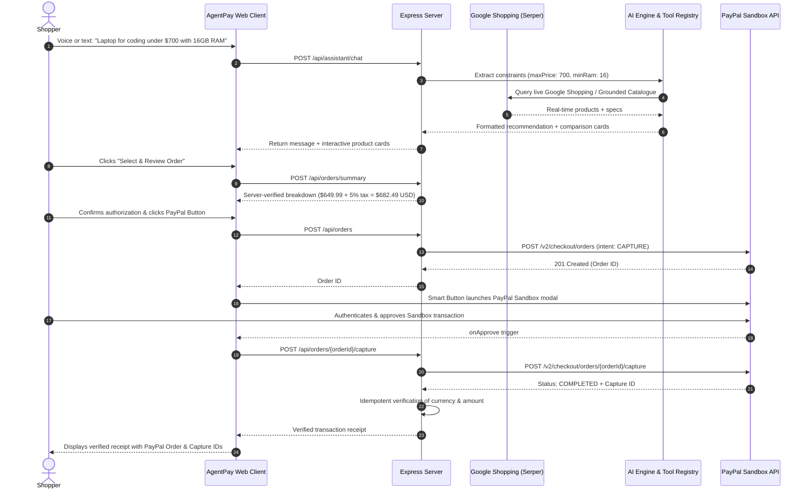

# 🛍️ AgentPay — Autonomous AI Shopping & PayPal Checkout Agent

[](LICENSE)
[](server/tests)
[](https://developer.paypal.com/)
[](https://serper.dev)
[](https://react.dev/)
[](https://nodejs.org/)
[](https://tailwindcss.com/)

> **Submission for the "Build What's Next with PayPal and AI" Hackathon.**

**AgentPay** is an autonomous, explainable AI shopping agent that bridges the gap between natural language product discovery and user-authorized, server-verified checkout through the official **PayPal Orders v2 API and Sandbox environment**.

Unlike standard shopping chatbots that stop at generic advice or hallucinate non-existent inventory, AgentPay combines **real-time global web product search (Google Shopping via Serper)**, **deterministic constraint enforcement (RAM, budget ceilings, negative accessory filtering)**, **in-depth hardware architectural breakdowns**, **hands-free voice interaction**, and an authentic **PayPal Sandbox checkout pipeline** with strict server-side price authority and idempotent payment capture.

---

## 🌟 Key Features

### 1. 🔍 Infinite Live Product Discovery
- **Real-Time Google Shopping:** Powered by the Serper API, queries live web commerce to fetch real prices, merchant names (Amazon, Walmart, Best Buy, etc.), ratings, and product images.
- **Negative Accessory Filtering:** Intelligent regex filtering prevents accessory clutter (e.g., searches for "iPhone 16" or "Samsung Galaxy" will not return cases, screen protectors, or cables unless explicitly requested).
- **Grounded Verification Fallback:** Paired with an internal curated catalog and in-memory 5-minute TTL caching for ultra-fast, resilient browsing.

### 2. 🧠 Deterministic Constraint Enforcement & AI Tool Registry
- **Zero Hallucination:** Eliminates models that recommend products outside user requirements.
- **Strict Budget Ceilings & Hardware Gates:** A user's maximum price ceiling and minimum hardware specs (e.g., minimum 16 GB RAM) are strictly enforced in code.
- **AI Tool Calling Architecture:**
  - `search_products(filters)`: Executes query, category, and spec matching across live web and grounded catalogue.
  - `get_product_details(productId)`: Generates granular technical breakdowns (processor micro-architecture, memory bus, thermal design, pros/cons).
  - `compare_products(productIds)`: Compiles structured side-by-side spec comparison tables.
  - `prepare_order_summary(items)`: Computes server-verified line items, taxes, and order proposals.

### 3. 🎙️ Natural Voice & Conversational Intelligence
- **Speech-to-Text (Microphone):** Low-latency voice queries powered by the native Web Speech API.
- **Read-Aloud (Text-to-Speech):** Hear the agent's product explanations and technical recommendations read aloud.
- **General & Deep Q&A Brain:** Ask hardware comparison questions or architectural advice with deep, contextual explanations.

### 4. 💳 Official PayPal Orders v2 Sandbox Integration
- **Server Price Authority:** Client-supplied prices are strictly ignored. The Express backend calculates the exact line-item total and 5% tax before issuing PayPal order payloads.
- **Smart Payment Buttons:** Powered by `@paypal/react-paypal-js` for a native, trusted checkout experience.
- **Idempotent Server-Side Capture:** POST `/v2/checkout/orders/{id}/capture` verifies order status `COMPLETED`, checks currency (`USD`), validates captured amounts, and prevents accidental double charges.
- **Verified Transaction Receipts:** Generates an immediate post-payment receipt displaying the verified PayPal Order ID, Capture ID, Payer info, and timestamp.

---

## 🏗️ System Architecture



---

## 🛠️ Tech Stack

| Layer | Technologies |
| :--- | :--- |
| **Payment Gateway** | PayPal Developer Platform, Orders v2 API, OAuth2 Client Credentials, `@paypal/react-paypal-js` |
| **Backend** | Node.js (v24), Express, ES Modules, Native Fetch |
| **Product Discovery** | Serper.dev (Google Shopping REST API), Grounded JSON catalog, 5-minute TTL cache |
| **Frontend** | React 18, Vite, Tailwind CSS, Lucide Icons |
| **Voice & Audio** | Native Web Speech API (SpeechRecognition & SpeechSynthesis) |
| **Testing** | Node.js native test runner (`node --test`), automated integration tests against live PayPal Sandbox |

---

## 📋 Prerequisites

- **Node.js**: v18.0.0 or higher (tested on Node.js v24)
- **npm**: v9.0.0 or higher
- A **PayPal Developer Account** with Sandbox credentials ([developer.paypal.com](https://developer.paypal.com/))
- *(Optional)* A **Serper API Key** ([serper.dev](https://serper.dev)) for live Google Shopping searches (2,500 free queries)

---

## 🚀 Quick Start Guide

### 1. Clone the Repository
```bash
git clone https://github.com/ChinmayaBiswal7/AgentPay.git
cd AgentPay
```

### 2. Configure Environment Variables
Copy `.env.example` to `.env`:
```bash
cp .env.example .env
```

Edit `.env` and provide your credentials:
```env
# PayPal Sandbox Credentials (developer.paypal.com)
PAYPAL_CLIENT_ID=your_paypal_sandbox_client_id_here
PAYPAL_CLIENT_SECRET=your_paypal_sandbox_client_secret_here
PAYPAL_BASE_URL=https://api-m.sandbox.paypal.com

# Server Configuration
PORT=5000
APP_BASE_URL=http://localhost:5000

# Optional: Real-Time Google Shopping API (serper.dev)
SERPER_API_KEY=your_serper_api_key_here

# Optional: AI Provider (auto, gemini, or openai)
AI_PROVIDER=auto
```

### 3. Install Dependencies
```bash
npm install
npm --prefix client install
```

### 4. Run the Automated Test Suite
Run the 12 end-to-end unit and integration tests (including live PayPal Sandbox OAuth & Orders v2 tests):
```bash
npm test
```

Expected output:
```
✔ should extract structured intent from the hackathon user request
✔ should execute tools and return grounded catalog recommendations within constraints
✔ should prepare order proposal if checkout action is triggered
✔ should strictly exclude products exceeding budget ceiling
✔ should filter by minimum RAM requirement
✔ should calculate server-side order summary and reject invalid inputs
✔ should authenticate with PayPal Sandbox and acquire OAuth Bearer token
✔ should create an authentic order on PayPal Sandbox with server-calculated price
✔ should fail cleanly when invalid product is ordered
ℹ tests 12 passed
```

### 5. Build and Launch the Application

```bash
# Build the React frontend
npm run build:client

# Start the unified Express server
npm start
```
Visit **`http://localhost:5000`** in your browser.

---

## 💳 Testing the PayPal Sandbox Flow

1. Go to the [PayPal Developer Dashboard](https://developer.paypal.com/dashboard/accounts) > **Testing Tools** > **Sandbox Accounts**.
2. Note the email and password of a default **Personal (Buyer)** Sandbox account.
3. In AgentPay:
   - Ask: *"Find me a laptop for programming under $700 with at least 16 GB RAM and good battery life."*
   - Click **"Review Order"** on the Lenovo ThinkBook 15 or Acer Aspire 5.
   - Verify the server-calculated breakdown and check the authorization checkbox:
     > *"I authorize AgentPay to create a PayPal Sandbox order for $682.49 USD. I understand no real money will be charged."*
   - Click the yellow **PayPal Checkout** button.
   - Log in with your Sandbox Buyer account and click **Complete Purchase**.
   - Review your verified receipt containing the authentic **PayPal Order ID** and **Capture ID**!

---

## 🔒 Security & Industry Standards

- **Zero-Trust Pricing:** Client-submitted prices are never accepted. All subtotals and taxes are re-computed and validated on the backend.
- **Server-Isolated Secrets:** `PAYPAL_CLIENT_SECRET` and `SERPER_API_KEY` are kept exclusively in server environment variables and never exposed to client bundles or repository commits.
- **Capture Idempotency:** The backend tracks order states to prevent duplicate charges from network retries or repeated user clicks.
- **Safe Sandbox Separation:** The app clearly indicates test transactions and avoids misleading users regarding real delivery or payment deductions.

---

## 📄 License

This project is licensed under the [MIT License](LICENSE).
