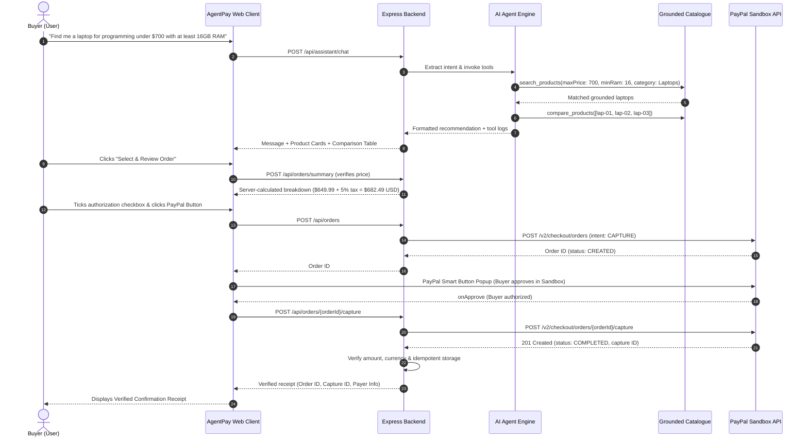

# 🛍️ AgentPay — AI-Powered Shopping & PayPal Payment Agent

[](LICENSE)
[](https://developer.paypal.com/)
[](https://react.dev/)
[](https://nodejs.org/)
[](https://tailwindcss.com/)

> Built for the **Build What's Next with PayPal and AI Hackathon**.

AgentPay is an autonomous, explainable AI shopping assistant that bridges the gap between natural language product discovery and user-authorized checkout through the official **PayPal Developer Platform and Sandbox environment**.

Unlike typical chatbots that merely generate conversational answers without an actionable purchasing path, **AgentPay** extracts buyer constraints, executes deterministic catalogue search and comparison tools, calculates trusted pricing server-side, and initiates genuine **PayPal Orders v2** transactions.

---

## 🌟 Key Features

1. **Natural Language Intent Extraction**: Understands user criteria such as category, strict budget ceilings, RAM requirements, brands, and intended use-cases (e.g. programming, gaming, focus).
2. **Deterministic & Grounded Recommendations**: Prevents AI hallucination. The AI is strictly constrained to catalogue data; products exceeding budget limits or lacking inventory are deterministically filtered.
3. **Controlled Tool Architecture**:
   - `search_products(filters)`: Executes query and specification matching.
   - `get_product_details(productId)`: Retrieves full specifications, pros, cons, and stock.
   - `compare_products(productIds)`: Generates side-by-side spec and value comparisons.
   - `prepare_order_summary(items)`: Computes server-calculated subtotals, tax, and totals in USD.
4. **Transparent Tool Execution Logging**: Displays a live badge showing tools executed, arguments passed, and latency in milliseconds.
5. **Interactive Side-by-Side Comparison**: Visually compares competing items across prices, processors, RAM, battery life, and ratings.
6. **Zero-Trust Server-Side Calculation**: Client-supplied prices and totals are never trusted. All calculations are executed on the backend.
7. **Genuine PayPal Sandbox Checkout**:
   - Uses the official `@paypal/react-paypal-js` SDK.
   - Backend creates orders via PayPal Orders v2 (`intent: CAPTURE`).
   - Secure server-side capture via `POST /v2/checkout/orders/{id}/capture`.
   - Complete verification: status is `COMPLETED`, currency is `USD`, and amounts match expected order totals.
8. **Idempotency & Duplicate Protection**: Prevents double-billing and ensures idempotent order capture.
9. **Verified Transaction Receipts**: Instant receipt modal with PayPal Order ID, Capture ID, Payer details, timestamp, and amount.

---

## 🏗️ System Architecture



---

## 🛠️ Tech Stack & Integrations

- **PayPal Developer Platform**: Orders v2 API (`/v2/checkout/orders`), OAuth2 Client Credentials authentication, Capture endpoint, PayPal JavaScript SDK.
- **Backend**: Node.js v24, Express, native ES modules.
- **Frontend**: React 18, Vite, Tailwind CSS, Lucide React icons, `@paypal/react-paypal-js`.
- **AI Engine**: Hybrid LLM / deterministic NLP rule-and-tool calling engine with transparent execution telemetry.
- **Testing**: Node.js native test runner (`node --test`), automated integration tests against live PayPal Sandbox.

---

## 📋 Prerequisites

- **Node.js**: v18 or higher (tested on Node.js v24)
- **npm**: v9 or higher
- A **PayPal Developer Account** with Sandbox credentials ([developer.paypal.com](https://developer.paypal.com/))

---

## 🚀 Quick Start Guide

### 1. Clone the repository
```bash
git clone <repo-url>
cd "Pay Pal"
```

### 2. Configure Environment Variables
Copy `.env.example` to `.env`:
```bash
cp .env.example .env
```

Edit `.env` and fill in your PayPal Sandbox credentials:
```env
# PayPal Sandbox Credentials
PAYPAL_CLIENT_ID=your_paypal_sandbox_client_id_here
PAYPAL_CLIENT_SECRET=your_paypal_sandbox_client_secret_here
PAYPAL_BASE_URL=https://api-m.sandbox.paypal.com

# Server Port
PORT=5000
APP_BASE_URL=http://localhost:5000

# AI Provider (Optional: auto, gemini, or openai)
AI_PROVIDER=auto
```

### 3. Install Dependencies
```bash
npm install
npm --prefix client install
```

### 4. Run the Automated Test Suite
Verify catalogue filters, budget exclusions, intent parsing, and live PayPal Sandbox API communication:
```bash
npm test
```

Expected output:
```
✔ should extract structured intent from the hackathon user request
✔ should execute tools and return grounded catalog recommendations within constraints
✔ should prepare order proposal if checkout action is triggered
✔ should strictly exclude products exceeding budget ceiling
✔ should authenticate with PayPal Sandbox and acquire OAuth Bearer token
✔ should create an authentic order on PayPal Sandbox with server-calculated price
ℹ tests 12 passed
```

### 5. Start the Application

#### Production Mode (Single port):
```bash
npm run build:client
npm start
```
Open **`http://localhost:5000`** in your browser.

#### Development Mode (Hot Reloading):
In terminal 1 (Backend):
```bash
npm start
```
In terminal 2 (Frontend with Vite HMR):
```bash
npm run client
```
Open **`http://localhost:5173`** in your browser.

---

## 💳 Testing with PayPal Sandbox Accounts

To complete a test transaction:
1. Log in to [PayPal Developer Dashboard](https://developer.paypal.com/dashboard/accounts).
2. Go to **Testing Tools** > **Sandbox Accounts**.
3. Copy the email and password for a **Buyer** (Personal) account.
4. In AgentPay:
   - Ask: *"Find me a laptop for programming under $700 with at least 16 GB RAM and good battery life."*
   - Click **"Select & Review Order"** on the Lenovo ThinkBook or Acer Aspire.
   - Review the server-calculated breakdown and check the authorization checkbox.
   - Click the yellow **PayPal Checkout** button.
   - Enter your Sandbox Buyer credentials in the PayPal modal and click **Complete Purchase**.
   - Watch the verified receipt modal appear with your verified PayPal Order ID and Capture ID!

---

## 🔒 Security Best Practices Implemented

- **Server-Side Secret Storage**: `PAYPAL_CLIENT_SECRET` is never transmitted to the browser or bundled in frontend client builds.
- **Server Price Authority**: Product costs, tax, and order totals are calculated exclusively by the backend using server-side catalog data.
- **Client Amounts Rejected**: Even if an attacker manipulates client state, the backend overrides and rejects any discrepancy.
- **Post-Capture Verification**: Payment is only deemed successful after the backend receives and validates status `COMPLETED` directly from PayPal's capture endpoint.
- **Idempotency Protection**: Repeat capture requests for the same order ID return the recorded receipt without duplicate billing.

---

## 📄 License

This project is licensed under the [MIT License](LICENSE).
